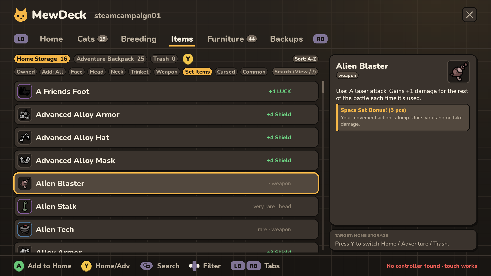

# MewDeck

A **controller-first Mewgenics save editor** for Linux handhelds: ROG Ally or Steam Deck on
**Bazzite / SteamOS**, with the game running through **Proton**. Add it to Steam once and use it
from Game Mode with the gamepad. It edits the save **in place** inside the Proton prefix, so there's
no copying files around, and it backs the save up before every write.


| Cats | Cat editor | Items |
|---|---|---|
|  |  |  |

---

## Install on the Ally (Bazzite), once

Do this in **Desktop Mode** (Steam menu → Power → Switch to Desktop).

**1. Get the code.** The repo is private, so use one of these:

- **Browser (easiest):** open this repo on github.com in Firefox, sign in, then **Code → Download ZIP**.
  Extract it into your home folder, for example `~/mewdeck`.
- **Terminal (Konsole):**
  ```bash
  brew install gh            # Bazzite ships Homebrew
  gh auth login              # pick GitHub.com → HTTPS → login with a web browser
  gh repo clone thedankest/mewdeck ~/mewdeck
  ```

**2. Install.** Run this in Konsole:

```bash
cd ~/mewdeck
./install.sh
```

That's it. The installer:

- builds a private Python environment with `pygame-ce` (needs internet the first time),
- adds a **MewDeck** entry with an icon to the app menu,
- **adds MewDeck to Steam automatically**, for every Steam account on the device, along with library artwork
  (capsule, banner, hero, logo, icon). Steam rewrites its shortcut list when it exits, so the installer
  **closes Steam, writes the shortcut, and restarts Steam**. Running it again updates the entry instead of adding a duplicate.

**3.** Switch back to **Game Mode**. MewDeck is in your library under *Non-Steam*. Launch it like a game.
The default "Gamepad" controller layout is all it needs.

> If the automatic step ever fails, the installer says so. You can then add it by hand: Steam (Desktop Mode) →
> **Games → Add a Non-Steam Game to My Library…** → tick **MewDeck**.

### Uninstall

```bash
cd ~/mewdeck && ./uninstall.sh    # removes the Steam shortcut + artwork, app menu entry, app; keeps backups
```

### Update later

```bash
cd ~/mewdeck && git pull && ./install.sh     # or download the ZIP again and re-run ./install.sh
```

### Launch without Steam

```bash
~/.local/share/mewdeck/app/run.sh              # fullscreen
~/.local/share/mewdeck/app/run.sh --windowed   # windowed, for Desktop Mode
```

---

## Using it

1. **Close Mewgenics first** (or use *Close game, reset & relaunch*). If the game is running, a red
   **GAME RUNNING** badge appears and saving is blocked, because the game would overwrite your edits.
2. **No browsing for files.** MewDeck finds your save by itself in the default Steam location
   (`~/.local/share/Steam/steamapps/compatdata/686060/…/Glaiel Games/Mewgenics/<steamid>/saves/`), and also in
   any other Steam library or in Flatpak Steam. With one campaign, it opens straight to the Home screen.
3. Edit, then press **☰ (Menu)** to save. Every save makes a backup first.

### Controls

| Button | Action |
|---|---|
| **LB / RB** | Switch tabs: Home · Cats · Items · Backups. In the cat editor: previous/next cat |
| **D-pad / left stick** | Move · ◀ ▶ change a value (hold to speed up) |
| **A** | Select / confirm |
| **B** | Back / cancel |
| **X** | Context action: 99,999 gold, remove an item, back up now |
| **Y** | Reload from disk / rescan saves |
| **☰ Menu** | Save pending changes |

Touch works too: tap to select, tap again to open. A keyboard also works: arrows, Enter, Esc, Q/E, Tab.

### Features

| | |
|---|---|
| **Steven / save-scum reset** | One press: `savescumlocation = 0` (it shows where the penalty was armed: battle, house boss, event), strike rows capped to 1. There's also *wipe all strikes* and **Close game → reset → relaunch** |
| **Auto-block Steven** | Optional toggle. Adds two SQLite `BEFORE INSERT/UPDATE … RAISE(IGNORE)` triggers to the save, so the game's own write that arms the penalty is silently dropped and every other write goes through. Turn it off any time. Steam Cloud restoring an older copy removes it, so check that it still shows **ON** |
| **Gold & food** | ◀ ▶ ±10 (hold for ±100 / ±1000), X = 99,999 |
| **Cats** | Base stats 1–7 (5 is the game's baseline, so bars are coloured red→green), level, age, sex, retired. Filters: House, Adventure, Retired, Gone |
| **Items** | 1,000+ items by slot, queued into storage |
| **Backups** | Automatic before every save. The very first backup (*pristine*) is never deleted. Restore from the Backups tab |

### Safety

- After every edit, MewDeck re-reads the save and checks that each change reads back exactly and that
  nothing else moved. If anything doesn't match, **nothing is written** and you get a message.
- A write goes to a temp file, passes `PRAGMA integrity_check`, then atomically replaces the save.
- Level and age are locked for cats whose fields the parser can't place reliably.
- Backups live in `~/.local/share/mewdeck/backups`, outside the Steam Cloud folder.
- **Steam Cloud:** if Steam reports a sync conflict the next time you start the game, pick the **local** save.

---

## Command line

```bash
run.sh --list                     # detected saves + Steven status
run.sh --reset-steven PATH.sav    # headless Steven reset (backs up first)
run.sh --save PATH.sav            # open a specific save
MEWDECK_SAVE_DIR=/path run.sh     # look for saves somewhere else
```

## Development

```bash
python3 tests/test_savefile.py                              # synthetic tests
MEWDECK_TEST_SAVE=/path/to/steamcampaign01.sav python3 tests/test_savefile.py   # + real-save round trip (uses a temp copy)
```

## Credits / license

- Save parsing and cat/item writing come from
  [accessiblefish/mewgenics-save-editor](https://github.com/accessiblefish/mewgenics-save-editor) (AGPL-3.0),
  vendored at `mewdeck/vendor/mewparser.py`, along with its item list.
- The Steven reset follows [TaliesinYang/mewgenics-bye-bye-steven](https://github.com/TaliesinYang/mewgenics-bye-bye-steven).
- Proton save paths: [Yggdraszil/mewgenics_patcher](https://github.com/Yggdraszil/mewgenics_patcher).
- UI ideas (stat baseline colours, pristine backup) came from [mewgenicseditor.com](https://mewgenicseditor.com/) and
  [MewgenicsSaveEditor on Nexus](https://www.nexusmods.com/mewgenics/mods/20). No code was taken from either.
- Font: [Nunito](https://github.com/googlefonts/nunito) (SIL OFL 1.1, `mewdeck/fonts/OFL.txt`).

MewDeck is AGPL-3.0 because of the vendored parser. It's a personal, non-commercial tool.
