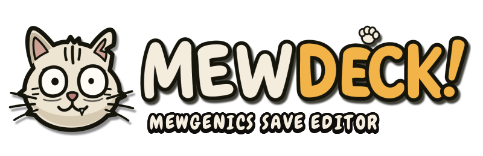
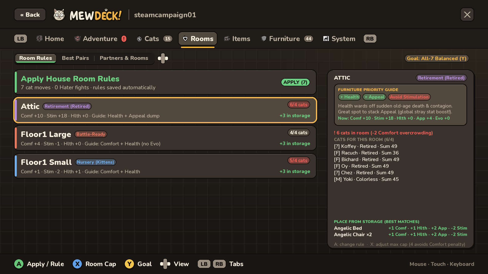
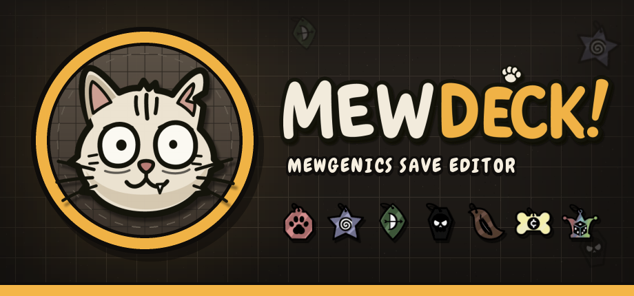

<div align="center">



**Native 1080p, gamepad-first Mewgenics save editor for ROG Ally, Steam Deck & Linux (Bazzite / SteamOS)**

[-ffb44c?style=for-the-badge&logo=steam&logoColor=14101a)](https://github.com/thedankest/mewdeck/releases/latest)
[](#one-click-install-on-bazzite--steamos)
[](#controls)
[](LICENSE)

*Edit saves **in place** straight inside your Proton prefix — automatic backups before every write, strict round-trip verification, and full Steam Big Picture artwork.*

<br />


</div>

> [!NOTE]
> **New in v1.8** — Hand-inked Mewgenics-style **SVG cat logo + `MEWDECK!` wordmark** (Chewy display font) across the app & all Steam Big Picture artwork · **Rooms tab** with a rule-based **House Manager** (Retirement / Nursery / Battle-Ready / Breeding / Sickbay rooms, Hater fight prevention, overcrowding warnings) and a per-room **Furniture Priority Guide** with best Storage picks · **Jester & special-cat parser fix** so no cat is ever silently dropped from your house or party.

---

## Gallery

<table>
  <tr>
    <td align="center" width="50%">
      <br />
      <sub><b>Adventure Hub (Run &amp; Steven · Party · Backpack)</b> — Dedicated active-run tab with 4-cat dossier &amp; backpack</sub>
    </td>
    <td align="center" width="50%">
      <br />
      <sub><b>Cat Editor</b> — Zero-scroll <code>Build &amp; Gear · Stats · Profile</code> sections, hoverable cards &amp; gear bar</sub>
    </td>
  </tr>
  <tr>
    <td align="center" width="50%">
      <br />
      <sub><b>House Cats &amp; Graveyard</b> — Official in-game stat sticker trays, Sex/Sort filters, CoI% &amp; revive</sub>
    </td>
    <td align="center" width="50%">
      <br />
      <sub><b>Rooms (House Manager)</b> — Room Rules with Hater fight prevention, Furniture Priority Guide &amp; best Storage picks</sub>
    </td>
  </tr>
  <tr>
    <td align="center" width="50%">
      <br />
      <sub><b>Armor Sets Overview & Items (989 Sprites)</b> — Live set ownership progress, piece breakdown & 1-press add missing pieces</sub>
    </td>
    <td align="center" width="50%">
      <br />
      <sub><b>Furniture (633 Sprites)</b> — Unplaced Storage, room role &amp; priority-aware Room Totals, Full Catalog</sub>
    </td>
  </tr>
</table>

---

## One-Click Install on Bazzite / SteamOS

> [!TIP]
> **No ZIP extraction, no `git`, no manual Steam setup.** Download one self-contained file and let the native KDE / GNOME wizard do everything.

1. Switch to **Desktop Mode** (*Steam → Power → Switch to Desktop*).
2. Download **[`MewDeck-Installer.run`](https://github.com/thedankest/mewdeck/releases/latest)** from the latest release.
3. Double-click **`MewDeck-Installer.run`** *(if your browser cleared the executable bit, right-click → Properties → Permissions → **Is Executable**, or paste `bash ~/Downloads/MewDeck-Installer.run --gui` in Konsole)*.
4. Click **Install / Update** in the wizard:
   - Installs MewDeck and all unobfuscated game data
   - Creates a private Python (`pygame-ce`) environment
   - Adds **MewDeck** to Steam automatically with full library artwork *(portrait capsule, wide banner, hero, logo, and icon)*
5. Switch back to **Game Mode** and launch **MewDeck** under **Non-Steam**.
6. **Already installed?** Open MewDeck and go to **System → Settings & Tools → Check for Updates** (then **Refresh Steam Artwork** to immediately swap in the new Big Picture art).

<p align="center">
  <br />
  <sub><b>Automatic Steam Big Picture / Game Mode Artwork</b> — Portrait capsule, wide banner, hero, transparent logo &amp; icon</sub>
</p>

<details>
<summary><b>Install or update via terminal / git instead</b></summary>

```bash
# First time
gh repo clone thedankest/mewdeck ~/mewdeck
cd ~/mewdeck && ./install.sh          # or ./install.sh --gui

# Update later
cd ~/mewdeck && git pull && ./install.sh

# Uninstall (keeps all save backups)
cd ~/mewdeck && ./uninstall.sh
```

</details>

---

## Features

| Area | What MewDeck can do |
| :--- | :--- |
| **Clean Zero-Overlap Architecture** | Every game domain has one canonical home: **Home** (House tools & 7 pure resources, zero scroll), **Adventure** (`Run & Steven · Party · Backpack`), **Cats** (House & Graveyard), **Rooms** (`Room Rules · Best Pairs · Partners & Rooms`), **Items** (`Home Storage · Armor Sets · Catalog`), **Furniture**, and **System** (`Backups · Settings & Tools`). |
| **In-Game Sketchbook UI, Branding & 3,694 Wiki Sprites** | Hand-inked Mewgenics sketchbook aesthetic with distinct top-tab, segmented sub-view (`LT`/`RT`), and filter-pill hierarchy, a hand-crafted **Mewgenics-style SVG cat logo + `MEWDECK!` wordmark** (Chewy display font) shared by the app and all 5 Steam Big Picture assets, **3,694 offline wiki sprites** (including white-backed official **Stat Sticker SVGs**), and sub-3 ms/frame cached rendering. |
| **Explicit Save-Only Workflow & Header Controls** | Every edit queues cleanly with a `QUEUED` badge — **nothing writes to disk until you click `Save (N)`** in the header (or press `☰` Menu), with clickable **`« Back`**, **`Discard`**, automatic pristine + rolling backups, and a live **Backup Diff** viewer in **System**. |
| **Rooms: House Manager & Breeding Helper** | Give each room a role (**Retirement, Nursery, Battle-Ready, Breeding, Sickbay, Everyone Else, Locked**) and MewDeck plans every cat move with **Hater fight prevention**, **overcrowding Comfort warnings** (-1 Comfort per cat over 4) and **1-press Apply**; rules persist between sessions. Each room shows a **Furniture Priority Guide** (what to stack, what to avoid) with the best matching pieces from Storage. Plus **Best Pairs** with **Offspring Simulator** (expected stats, 7s, Spell/Passive %, exact pedigree **CoI%**) and **Partners & Rooms**. |
| **Robust Save Parsing (Jester Fix)** | Variable-length cat records (Jester & other special cats with long class tags, extra abilities or equipment) are parsed exactly, with a pattern-scanning fallback so no cat in your house or adventure party is ever silently dropped. |
| **Cat Editor, Interactive Cards & Gear Mini-Bar** | Zero-scroll `Build & Gear · Stats · Profile` sections (`LT`/`RT`) synced with hoverable **Ability, Passive & Disorder Cards** + **5-Slot Equipped Gear Mini-Bar**, **Build Presets & Clone/Paste**, **Equip Full Armor Set**, **Rename**, Base + **Level-Up Bonuses** (live Effective Stats tray), Mutations, and Class Collars. |
| **Armor Sets Overview, Items, Furniture & System Tools** | Dedicated **Armor Sets** overview tracking live piece ownership across Home/Adventure/Cats with **1-press Add Missing Pieces**, bidirectional Home ↔ Adventure item transfer, **633 Furniture** items with live room totals, **Clone Save Slots**, and **System → Settings & Tools** (Integrity Check, Reload, Refresh Steam Artwork, UI Sounds, In-App Updater). |

---

## Controls

| Input | Action |
| :--- | :--- |
| **`LB` / `RB`** | Switch top-level tabs (*Home · Adventure · Cats · Rooms · Items · Furniture · System*) · Prev/next cat in Cat Editor |
| **`LT` / `RT`** | Switch sub-views in **Adventure** (*Run & Steven · Party · Backpack*) & **Cat Editor** (*Build & Gear · Stats · Profile*) · Fast page scroll (±10 rows) in long lists |
| **D-Pad / Left Stick** | Navigate · `◀ ▶` adjust values (hold to accelerate) or switch filters / Passive Tier 1–2 |
| **`A`** | Select / open editor / add item / **move owned item Home ↔ Adventure** / confirm |
| **`B`** | Back / cancel |
| **`X`** | Context action: max resource, heal/revive cat, remove item/furniture, clear slot, manual backup |
| **`Y`** | Sort (**Cats** / **Items**) · Stat Goal (**Rooms**) · Inspect Cards (**Cat Editor**) · Mirror L↔R (**Mutations**) · Clear all disorders · Rescan saves |
| **View / `Select` (or `/`)** | Open built-in **Gamepad + Touch Search** · Clear all birth defects (Mutations) |
| **`☰` Menu** | Save all pending changes (with automatic backup) |

*Touchscreen (including a top-right `×` quit button) and keyboard (`Arrows`, `Enter`, `Esc`, `Q`/`E`, `X`, `Y`, `Tab`) also work everywhere.*

---

<details>
<summary><b>CLI flags, Diagnostics & Development</b></summary>

### Command line
```bash
~/.local/share/mewdeck/app/run.sh --windowed             # resizable window (Desktop Mode)
~/.local/share/mewdeck/app/run.sh --list                 # detected saves, injured count & Steven status
~/.local/share/mewdeck/app/run.sh --reset-steven PATH    # headless Steven + Déjà Vu reset (backs up first)
~/.local/share/mewdeck/app/run.sh --heal-all PATH        # headless heal all active cats (backs up first)
~/.local/share/mewdeck/app/run.sh --diag                 # live display & gamepad diagnostics
```

### Tests & building the one-click installer
```bash
python3 tests/test_savefile.py
MEWDECK_TEST_SAVE=/path/to/steamcampaign01.sav python3 tests/test_savefile.py
./build_installer.sh                                     # rebuilds MewDeck-Installer.run
```

> **Steam Cloud note:** if Steam asks about a Cloud sync conflict the next time you launch Mewgenics, pick the **local** save.

</details>

---

## Credits & License

- **LZ4 codec & ability/passive/disorder text:** [accessiblefish/mewgenics-save-editor](https://github.com/accessiblefish/mewgenics-save-editor) (AGPL-3.0)
- **Item descriptions, set bonuses, mutation/furniture/injury databases & binary format reference:** [michael-trinity/mewgenics-savegame-editor](https://github.com/michael-trinity/mewgenics-savegame-editor) (MIT)
- **Steven anti-save-scum reset:** [TaliesinYang/mewgenics-bye-bye-steven](https://github.com/TaliesinYang/mewgenics-bye-bye-steven)
- **Proton save paths:** [Yggdraszil/mewgenics_patcher](https://github.com/Yggdraszil/mewgenics_patcher)
- **Breeding simulation, pedigree CoI & room optimizer reference:** [PurpleMyst/mewgenics_breeding_helper](https://github.com/PurpleMyst/mewgenics_breeding_helper) (MIT) & [frankieg33/MewgenicsBreedingManager](https://github.com/frankieg33/MewgenicsBreedingManager)
- **Wiki sprites & icons:** [mewgenics.wiki.gg](https://mewgenics.wiki.gg/) (packed offline via `scripts/`)
- **Typography:** [Nunito](https://github.com/googlefonts/nunito) (SIL OFL 1.1) · [Chewy](https://fonts.google.com/specimen/Chewy) by Sideshow (Apache 2.0)

Licensed under **AGPL-3.0**. Personal, non-commercial tool.
