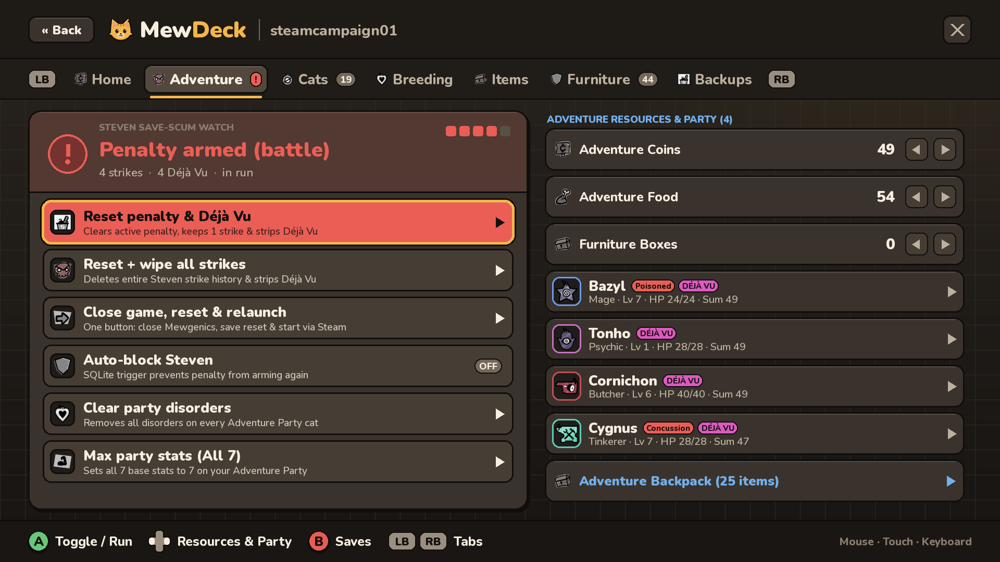
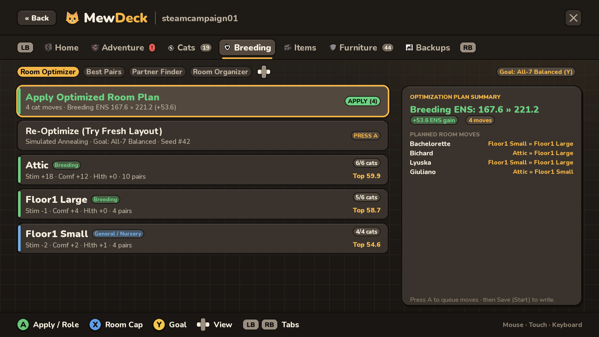

<div align="center">


# MewDeck

**Native 1080p, gamepad-first Mewgenics save editor for ROG Ally, Steam Deck & Linux (Bazzite / SteamOS)**

[-ffb44c?style=for-the-badge&logo=steam&logoColor=14101a)](https://github.com/thedankest/mewdeck/releases/latest)
[](#one-click-install-on-bazzite--steamos)
[](#controls)
[](LICENSE)

*Edit saves **in place** straight inside your Proton prefix — automatic backups before every write, strict round-trip verification, and full Steam library artwork.*

<br />


</div>

---

## Gallery

<table>
  <tr>
    <td align="center" width="50%">
      <br />
      <sub><b>Adventure Hub</b> — Steven Save-Scum Watch, Auto-block, Party Fixes & Live 4-Cat Party</sub>
    </td>
    <td align="center" width="50%">
      <br />
      <sub><b>Cat Editor</b> — Hoverable Ability/Disorder Cards, 5-Slot Equipped Gear Bar & Official Stat SVGs</sub>
    </td>
  </tr>
  <tr>
    <td align="center" width="50%">
      <br />
      <sub><b>Home & Adventure Cats</b> — Official in-game stat sticker trays, Sex/Sort filters, CoI% & Graveyard revive</sub>
    </td>
    <td align="center" width="50%">
      <br />
      <sub><b>Cat Organizer & Breeding Helper</b> — Instant memoized Room Optimizer, ENS pairs, CoI% & 1-press apply</sub>
    </td>
  </tr>
  <tr>
    <td align="center" width="50%">
      <br />
      <sub><b>Armor Sets Overview & Items (989 Sprites)</b> — Live set ownership progress, piece breakdown & 1-press add missing pieces</sub>
    </td>
    <td align="center" width="50%">
      <br />
      <sub><b>Furniture (633 Sprites)</b> — Unplaced Storage, Room Stat Totals & Full Catalog</sub>
    </td>
  </tr>
</table>

---

## One-Click Install on Bazzite / SteamOS

> [!TIP]
> **No ZIP extraction, no `git`, no manual Steam setup.** Download one self-contained file and let the native KDE / GNOME wizard do everything.

1. Switch to **Desktop Mode** (*Steam → Power → Switch to Desktop*).
2. Download **[`MewDeck-Installer.run`](https://github.com/thedankest/mewdeck/releases/latest)** from the latest release.
3. Double-click **`MewDeck-Installer.run`** *(if your browser cleared the executable bit, right-click → Properties → Permissions → **Is Executable**, or paste `bash ~/Downloads/MewDeck-Installer.run --gui` in Konsole)*.
4. Click **Install / Update** in the wizard:
   - Installs MewDeck and all unobfuscated game data
   - Creates a private Python (`pygame-ce`) environment
   - Adds **MewDeck** to Steam automatically with full library artwork *(portrait capsule, wide banner, hero, logo, and icon)*
5. Switch back to **Game Mode** and launch **MewDeck** under **Non-Steam**.

<details>
<summary><b>Install or update via terminal / git instead</b></summary>

```bash
# First time
gh repo clone thedankest/mewdeck ~/mewdeck
cd ~/mewdeck && ./install.sh          # or ./install.sh --gui

# Update later
cd ~/mewdeck && git pull && ./install.sh

# Uninstall (keeps all save backups)
cd ~/mewdeck && ./uninstall.sh
```

</details>

---

## Features

| Area | What MewDeck can do |
| :--- | :--- |
| **In-Game Sketchbook UI, Branding & 3,694 Wiki Sprites** | Hand-inked Mewgenics sketchbook aesthetic, custom notched-ear tabby emblem & full Steam Big Picture artwork, **3,694 offline wiki sprites** (including white-backed official **Stat Sticker SVGs** everywhere), and LRU-cached sub-3 ms/frame rendering for instant handheld feel. |
| **Separate Home & Adventure Tabs** | Cleanly separated **Home** (House Gold/Food, Collars, Storage, Heal All, Repair Gear, Strip Defects, Unlocks, Properties, Refresh Steam Artwork) and **Adventure** (Steven Save-Scum Watch, Auto-block, Party Fixes, Adv Coins/Food/Boxes, Live 4-Cat Party roster & Backpack jump) tabs. |
| **Explicit Save-Only Workflow & Header Controls** | Every edit queues cleanly with a `QUEUED` badge — **nothing writes to disk until you click `Save (N)`** in the header (or press `☰` Menu), with clickable **`« Back`**, **`Discard`**, automatic pristine + rolling backups, and a live **Backup Diff** viewer. |
| **Cat Organizer & Breeding Helper** | Instant memoized **Room Optimizer** with live **Optimization Plan Summary** (Before » After ENS gain & room moves) and **1-press Apply**, plus **Best Pairs** with **Offspring Simulator** (expected stats, 7s, Spell/Passive %, exact pedigree **CoI%**), **Partner Finder**, and **Room Organizer**. |
| **Cat Editor, Interactive Cards & Gear Mini-Bar** | Hoverable / gamepad-inspectable **Ability, Passive & Disorder Cards** + **5-Slot Equipped Gear Mini-Bar** with live tooltip previews (click/`A` to edit that exact slot), **Build Presets & Clone/Paste**, **Equip Full Armor Set**, **Rename**, Base + **Level-Up Bonuses** (with live Effective Stats tray), Mutations, and Class Collars. |
| **Armor Sets Overview, Items, Furniture & Self-Updater** | Dedicated **Armor Sets** overview tracking live piece ownership across Home/Adventure/Cats with **1-press Add Missing Pieces**, Home ↔ Adventure item transfer with icon stat deltas, **633 Furniture** items with live room totals, **Clone Save Slots**, and **in-app updates** right inside Game Mode. |

---

## Controls

| Input | Action |
| :--- | :--- |
| **`LB` / `RB`** | Switch tabs (*Home · Adventure · Cats · Breeding · Items · Furniture · Backups*) · Prev/next cat in Cat Editor |
| **`LT` / `RT`** | Fast page scroll (±10 rows) in long lists *(also `PageUp` / `PageDown` / `[` / `]`)* |
| **D-Pad / Left Stick** | Navigate · `◀ ▶` adjust values (hold to accelerate) or switch filters / Passive Tier 1–2 |
| **`A`** | Select / open editor / add item / **move owned item Home ↔ Adventure** / confirm |
| **`B`** | Back / cancel |
| **`X`** | Context action: max resource, heal/revive cat, remove item/furniture, clear slot, manual backup |
| **`Y`** | Switch **Home Storage / Adventure Backpack / Trash** (Items) · Mirror L↔R (Mutations) · Clear all disorders · Reload |
| **View / `Select` (or `/`)** | Open built-in **Gamepad + Touch Search** · Clear all birth defects (Mutations) |
| **`☰` Menu** | Save all pending changes (with automatic backup) |

*Touchscreen (including a top-right `×` quit button) and keyboard (`Arrows`, `Enter`, `Esc`, `Q`/`E`, `X`, `Y`, `Tab`) also work everywhere.*

---

<details>
<summary><b>CLI flags, Diagnostics & Development</b></summary>

### Command line
```bash
~/.local/share/mewdeck/app/run.sh --windowed             # resizable window (Desktop Mode)
~/.local/share/mewdeck/app/run.sh --list                 # detected saves, injured count & Steven status
~/.local/share/mewdeck/app/run.sh --reset-steven PATH    # headless Steven + Déjà Vu reset (backs up first)
~/.local/share/mewdeck/app/run.sh --heal-all PATH        # headless heal all active cats (backs up first)
~/.local/share/mewdeck/app/run.sh --diag                 # live display & gamepad diagnostics
```

### Tests & building the one-click installer
```bash
python3 tests/test_savefile.py
MEWDECK_TEST_SAVE=/path/to/steamcampaign01.sav python3 tests/test_savefile.py
./build_installer.sh                                     # rebuilds MewDeck-Installer.run
```

> **Steam Cloud note:** if Steam asks about a Cloud sync conflict the next time you launch Mewgenics, pick the **local** save.

</details>

---

## Credits & License

- **LZ4 codec & ability/passive/disorder text:** [accessiblefish/mewgenics-save-editor](https://github.com/accessiblefish/mewgenics-save-editor) (AGPL-3.0)
- **Item descriptions, set bonuses, mutation/furniture/injury databases & binary format reference:** [michael-trinity/mewgenics-savegame-editor](https://github.com/michael-trinity/mewgenics-savegame-editor) (MIT)
- **Steven anti-save-scum reset:** [TaliesinYang/mewgenics-bye-bye-steven](https://github.com/TaliesinYang/mewgenics-bye-bye-steven)
- **Proton save paths:** [Yggdraszil/mewgenics_patcher](https://github.com/Yggdraszil/mewgenics_patcher)
- **Breeding simulation, pedigree CoI & room optimizer reference:** [PurpleMyst/mewgenics_breeding_helper](https://github.com/PurpleMyst/mewgenics_breeding_helper) (MIT) & [frankieg33/MewgenicsBreedingManager](https://github.com/frankieg33/MewgenicsBreedingManager)
- **Wiki sprites & icons:** [mewgenics.wiki.gg](https://mewgenics.wiki.gg/) (packed offline via `scripts/`)
- **Typography:** [Nunito](https://github.com/googlefonts/nunito) (SIL OFL 1.1)

Licensed under **AGPL-3.0**. Personal, non-commercial tool.
