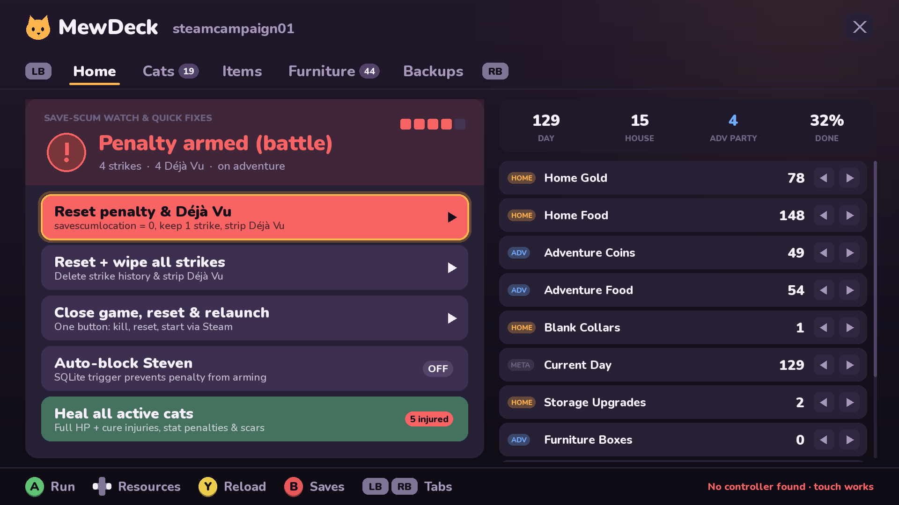
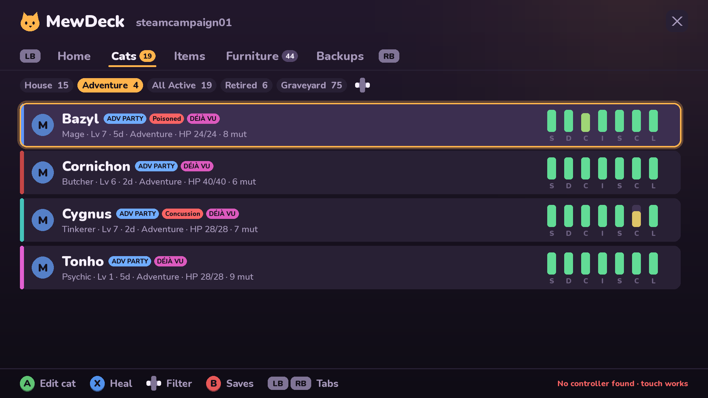
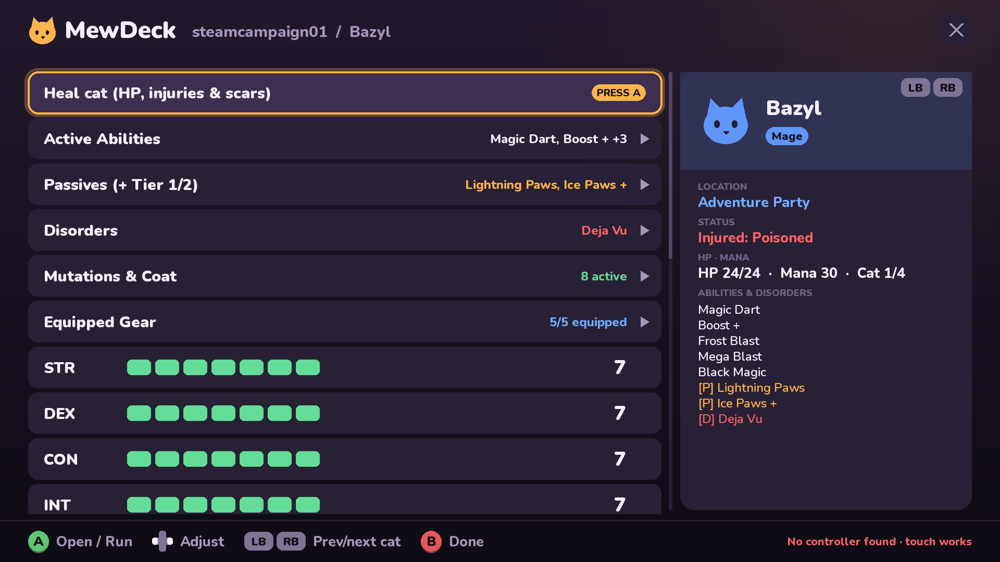

# MewDeck

A **controller-first Mewgenics save editor** for Linux handhelds: ROG Ally or Steam Deck on
**Bazzite / SteamOS**, with the game running through **Proton**. Add it to Steam once and use it
from Game Mode with the gamepad. It edits the save **in place** inside the Proton prefix, so there's
no copying files around, and it backs the save up before every write.



| Cats | Cat editor | Items |
|---|---|---|
|  |  |  |

---

## One-click install on the Ally (Bazzite)

Do this in **Desktop Mode** (Steam menu → Power → Switch to Desktop):

### Option 1: One-click installer wizard (no ZIP extraction)
1. Download **`MewDeck-Installer.run`** from this repo (or Releases).
2. Double-click **`MewDeck-Installer.run`** (if Firefox doesn't mark it executable, right-click → *Properties* → *Permissions* → *Is Executable*, or run `bash ~/Downloads/MewDeck-Installer.run --gui` in Konsole).
3. Click **Install / Update** in the KDE wizard — it installs MewDeck, sets up `pygame-ce`, creates the desktop entry, and **adds MewDeck to Steam automatically with full capsule, banner, hero, logo & icon artwork**.
4. Switch back to **Game Mode** and launch **MewDeck** under *Non-Steam*.

### Option 2: From git (for updates)
```bash
gh repo clone thedankest/mewdeck ~/mewdeck
cd ~/mewdeck && ./install.sh          # or ./install.sh --gui
```

Update later:
```bash
cd ~/mewdeck && git pull && ./install.sh
```

Uninstall:
```bash
cd ~/mewdeck && ./uninstall.sh        # removes Steam shortcut + artwork & app; keeps backups
```

### Launch without Steam

```bash
~/.local/share/mewdeck/app/run.sh              # fullscreen
~/.local/share/mewdeck/app/run.sh --windowed   # windowed, for Desktop Mode
```

---

## Using it

1. **Close Mewgenics first** (or use *Close game, reset & relaunch*). If the game is running, a red
   **GAME RUNNING** badge appears and saving is blocked, because the game would overwrite your edits.
2. **No browsing for files.** MewDeck finds your save by itself in the default Steam location
   (`~/.local/share/Steam/steamapps/compatdata/686060/…/Glaiel Games/Mewgenics/<steamid>/saves/`), and also in
   any other Steam library or in Flatpak Steam. With one campaign, it opens straight to the Home screen.
3. Edit, then press **☰ (Menu)** to save. Every save makes a backup first.

### Controls

| Button | Action |
|---|---|
| **LB / RB** | Switch tabs: Home · Cats · Items · Backups. In the cat editor: previous/next cat |
| **D-pad / left stick** | Move · ◀ ▶ change a value (hold to speed up) |
| **A** | Select / confirm |
| **B** | Back / cancel |
| **X** | Context action: 99,999 gold, remove an item, back up now |
| **Y** | Reload from disk / rescan saves |
| **☰ Menu** | Save pending changes |

Touch works too: tap to select, tap again to open. A keyboard also works: arrows, Enter, Esc, Q/E, Tab.

### Features

| | |
|---|---|
| **Steven / save-scum reset** | One press: `savescumlocation = 0`, strike rows capped or wiped, and strips **Déjà Vu** disorder from adventure cats. Includes **Close game → reset → relaunch** |
| **Auto-block Steven** | Optional SQLite `BEFORE INSERT/UPDATE … RAISE(IGNORE)` guard so the penalty can never arm again |
| **Heal all active cats** | One press on Home (or `--heal-all`): restores full HP and cures injuries, stat penalties, and visual scars across all house + adventure cats |
| **Home & Adventure resources** | Separate editors for Home Gold/Food, Adventure Coins/Food, Blank Collars, Day, Storage Upgrades, Furniture Boxes, Min Strays, and Completion % |
| **Cats (Home, Adventure & Graveyard)** | Separate House & Adventure party filters + Graveyard **Revive → Attic**. Edit base stats (1–7), Class (14 classes), Level, Age, Sex, Retired, **Active Abilities (6 slots)**, **Passives (2 slots + Tier 1/2 `+`)**, **Disorders (2 slots)**, **Mutations & Coat Texture (14 body parts + L↔R mirror)**, and **Equipped Gear (5 slots)** — all with unobfuscated English names & descriptions |
| **Items (Home Storage, Adventure Backpack & Trash)** | 1,021 items with unobfuscated descriptions, stat bonuses, durability, cursed flags, and **101 Armor Set Bonuses**. Browse owned items or add/remove separately for Home Storage, Adventure Backpack, and Trash |
| **Furniture & Rooms** | View Unplaced Storage and placed rooms with live Comfort/Stimulation/Health/Appeal/Evolution totals, plus add/remove from 633 furniture items |
| **Backups** | Automatic before every save. The very first backup (*pristine*) is never deleted. Restore from the Backups tab |

### Safety

- After every edit, MewDeck re-reads the save and checks that each change reads back exactly and that
  nothing else moved. If anything doesn't match, **nothing is written** and you get a message.
- A write goes to a temp file, passes `PRAGMA integrity_check`, then atomically replaces the save.
- Level and age are locked for cats whose fields the parser can't place reliably.
- Backups live in `~/.local/share/mewdeck/backups`, outside the Steam Cloud folder.
- **Steam Cloud:** if Steam reports a sync conflict the next time you start the game, pick the **local** save.

---

## Command line

```bash
run.sh --list                     # detected saves + Steven status
run.sh --reset-steven PATH.sav    # headless Steven reset (backs up first)
run.sh --save PATH.sav            # open a specific save
MEWDECK_SAVE_DIR=/path run.sh     # look for saves somewhere else
```

## Development

```bash
python3 tests/test_savefile.py                              # synthetic tests
MEWDECK_TEST_SAVE=/path/to/steamcampaign01.sav python3 tests/test_savefile.py   # + real-save round trip (uses a temp copy)
```

## Credits / license

- Save LZ4 codec & ability/passive/disorder text: [accessiblefish/mewgenics-save-editor](https://github.com/accessiblefish/mewgenics-save-editor) (AGPL-3.0).
- Item descriptions, set bonuses, mutation/furniture/injury databases & binary layout reference: [michael-trinity/mewgenics-savegame-editor](https://github.com/michael-trinity/mewgenics-savegame-editor) (MIT).
- The Steven reset follows [TaliesinYang/mewgenics-bye-bye-steven](https://github.com/TaliesinYang/mewgenics-bye-bye-steven).
- Proton save paths: [Yggdraszil/mewgenics_patcher](https://github.com/Yggdraszil/mewgenics_patcher).
- UI ideas (stat baseline colours, pristine backup) came from [mewgenicseditor.com](https://mewgenicseditor.com/) and
  [MewgenicsSaveEditor on Nexus](https://www.nexusmods.com/mewgenics/mods/20). No code was taken from either.
- Font: [Nunito](https://github.com/googlefonts/nunito) (SIL OFL 1.1, `mewdeck/fonts/OFL.txt`).

MewDeck is AGPL-3.0 because of the vendored parser. It's a personal, non-commercial tool.
