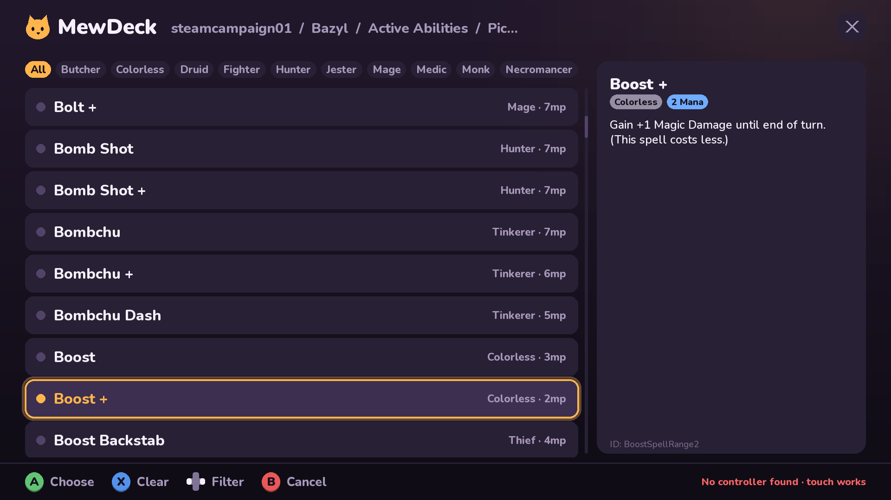
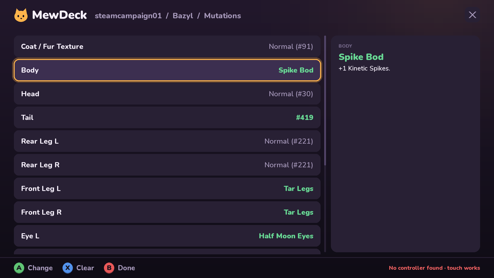
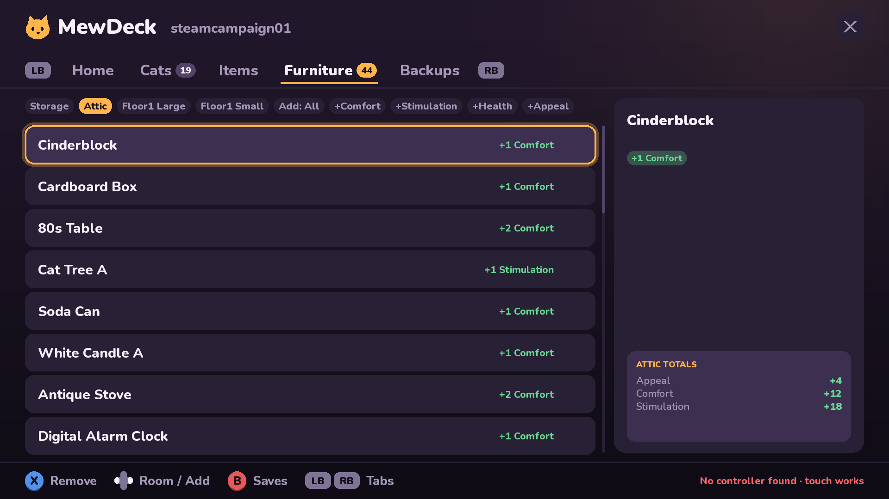

<div align="center">


# MewDeck

**Native 1080p, gamepad-first Mewgenics save editor for ROG Ally, Steam Deck & Linux (Bazzite / SteamOS)**

[-ffb44c?style=for-the-badge&logo=steam&logoColor=14101a)](https://github.com/thedankest/mewdeck/releases/latest)
[](#one-click-install-on-bazzite--steamos)
[](#controls)
[](LICENSE)

*Edit saves **in place** straight inside your Proton prefix — automatic backups before every write, strict round-trip verification, and full Steam library artwork.*

<br />


</div>

---

## Gallery

<table>
  <tr>
    <td align="center" width="50%">
      <br />
      <sub><b>Home & Adventure Cats</b> — Injuries, Déjà Vu, HP, mutations & Graveyard revive</sub>
    </td>
    <td align="center" width="50%">
      <br />
      <sub><b>Cat Editor</b> — Stats, class, abilities, passives, disorders, mutations & gear</sub>
    </td>
  </tr>
  <tr>
    <td align="center" width="50%">
      <br />
      <sub><b>Unobfuscated Abilities, Passives (+ Tier 1/2) & Disorders</b></sub>
    </td>
    <td align="center" width="50%">
      <br />
      <sub><b>Mutations & Coat Texture</b> — All 14 body parts, birth defects & L↔R mirror</sub>
    </td>
  </tr>
  <tr>
    <td align="center" width="50%">
      <br />
      <sub><b>Items & Armor Set Bonuses</b> — Home Storage, Adventure Backpack & Trash</sub>
    </td>
    <td align="center" width="50%">
      <br />
      <sub><b>Furniture & Rooms</b> — Live Comfort / Stimulation / Appeal totals + 633 items</sub>
    </td>
  </tr>
</table>

---

## One-Click Install on Bazzite / SteamOS

> [!TIP]
> **No ZIP extraction, no `git`, no manual Steam setup.** Download one 292 KB file and let the native KDE / GNOME wizard do everything.

1. Switch to **Desktop Mode** (*Steam → Power → Switch to Desktop*).
2. Download **[`MewDeck-Installer.run`](https://github.com/thedankest/mewdeck/releases/latest)** from the latest release.
3. Double-click **`MewDeck-Installer.run`** *(if your browser cleared the executable bit, right-click → Properties → Permissions → **Is Executable**, or paste `bash ~/Downloads/MewDeck-Installer.run --gui` in Konsole)*.
4. Click **Install / Update** in the wizard:
   - Installs MewDeck and all unobfuscated game data
   - Creates a private Python (`pygame-ce`) environment
   - Adds **MewDeck** to Steam automatically with full library artwork *(portrait capsule, wide banner, hero, logo, and icon)*
5. Switch back to **Game Mode** and launch **MewDeck** under **Non-Steam**.

<details>
<summary><b>Install or update via terminal / git instead</b></summary>

```bash
# First time
gh repo clone thedankest/mewdeck ~/mewdeck
cd ~/mewdeck && ./install.sh          # or ./install.sh --gui

# Update later
cd ~/mewdeck && git pull && ./install.sh

# Uninstall (keeps all save backups)
cd ~/mewdeck && ./uninstall.sh
```

</details>

---

## Features

| Area | What MewDeck can do |
| :--- | :--- |
| **Steven / Save-Scum Reset** | One press sets `savescumlocation = 0`, caps or wipes strike history, and strips **Déjà Vu** from adventure party cats. Includes **Close game → reset → relaunch** and an optional **Auto-block Steven** SQLite trigger. |
| **Heal All Active Cats** | One press on Home (or `--heal-all`) restores full HP and cures injuries (`Poisoned`, `Concussion`, `Broken Rib`, etc.), negative injury stat penalties, and visual scars across all house + adventure cats. |
| **Home & Adventure Resources** | Separate editors for **Home** (*Gold, Food, Blank Collars, Storage Upgrades, Min Strays*), **Adventure** (*Adventure Coins, Adventure Food, Furniture Boxes*), plus *Current Day* and *Completion %*. |
| **Cats (House, Adventure & Graveyard)** | Dedicated filters for **House**, **Adventure Party**, **All Active**, **Retired**, and **Graveyard** (1-press **Revive » Attic**). Edit Base Stats (1–7), Class (14 classes), Level, Age, Sex, Retired, and Equipped Gear (5 slots). |
| **Unobfuscated Abilities & Mutations** | Full English names, mana costs, stat bonuses, and descriptions for **1,912 Active Abilities**, **386 Passives (with Tier 1 / Tier 2 `+` toggle)**, **125 Disorders**, and **766 Mutations + Coat Textures** across all 14 body parts (with L↔R mirroring). |
| **Items & 101 Armor Set Bonuses** | Browse, add, and remove across **Home Storage**, **Adventure Backpack**, and **Trash** separately — all **1,021 items** include descriptions, stat bonuses, durability, cursed tags, and **Armor Set Bonuses**. |
| **Furniture & Rooms** | Inspect Unplaced Storage and every placed room with live **Comfort / Stimulation / Health / Appeal / Evolution** totals, plus add/remove from **633 furniture items**. |
| **Zero-Risk Safety** | Detects if Mewgenics is running (blocks writes so the game can't overwrite edits), keeps an untouchable **pristine** first backup plus 40 rolling backups, checks `PRAGMA integrity_check`, and re-parses every edited field before atomically replacing the `.sav`. |

---

## Controls

| Input | Action |
| :--- | :--- |
| **`LB` / `RB`** | Switch tabs (*Home · Cats · Items · Furniture · Backups*) · Prev/next cat in Cat Editor |
| **D-Pad / Left Stick** | Navigate · `◀ ▶` adjust values (hold to accelerate) or switch filters / Passive Tier 1–2 |
| **`A`** | Select / open editor / add item / confirm |
| **`B`** | Back / cancel |
| **`X`** | Context action: max resource, heal/revive cat, remove item/furniture, clear slot, manual backup |
| **`Y`** | Switch **Home Storage / Adventure Backpack / Trash** (Items) · Mirror L↔R (Mutations) · Clear all disorders · Reload |
| **`☰` Menu** | Save all pending changes (with automatic backup) |

*Touchscreen (including a top-right `×` quit button) and keyboard (`Arrows`, `Enter`, `Esc`, `Q`/`E`, `X`, `Y`, `Tab`) also work everywhere.*

---

<details>
<summary><b>CLI flags, Diagnostics & Development</b></summary>

### Command line
```bash
~/.local/share/mewdeck/app/run.sh --windowed             # resizable window (Desktop Mode)
~/.local/share/mewdeck/app/run.sh --list                 # detected saves, injured count & Steven status
~/.local/share/mewdeck/app/run.sh --reset-steven PATH    # headless Steven + Déjà Vu reset (backs up first)
~/.local/share/mewdeck/app/run.sh --heal-all PATH        # headless heal all active cats (backs up first)
~/.local/share/mewdeck/app/run.sh --diag                 # live display & gamepad diagnostics
```

### Tests & building the one-click installer
```bash
python3 tests/test_savefile.py
MEWDECK_TEST_SAVE=/path/to/steamcampaign01.sav python3 tests/test_savefile.py
./build_installer.sh                                     # rebuilds MewDeck-Installer.run
```

> **Steam Cloud note:** if Steam asks about a Cloud sync conflict the next time you launch Mewgenics, pick the **local** save.

</details>

---

## Credits & License

- **LZ4 codec & ability/passive/disorder text:** [accessiblefish/mewgenics-save-editor](https://github.com/accessiblefish/mewgenics-save-editor) (AGPL-3.0)
- **Item descriptions, set bonuses, mutation/furniture/injury databases & binary format reference:** [michael-trinity/mewgenics-savegame-editor](https://github.com/michael-trinity/mewgenics-savegame-editor) (MIT)
- **Steven anti-save-scum reset:** [TaliesinYang/mewgenics-bye-bye-steven](https://github.com/TaliesinYang/mewgenics-bye-bye-steven)
- **Proton save paths:** [Yggdraszil/mewgenics_patcher](https://github.com/Yggdraszil/mewgenics_patcher)
- **Typography:** [Nunito](https://github.com/googlefonts/nunito) (SIL OFL 1.1)

Licensed under **AGPL-3.0**. Personal, non-commercial tool.
